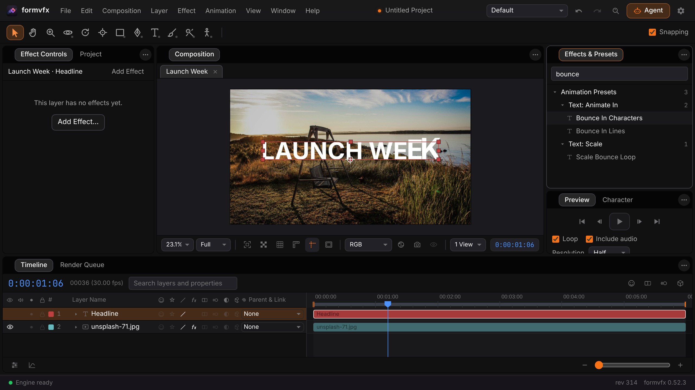
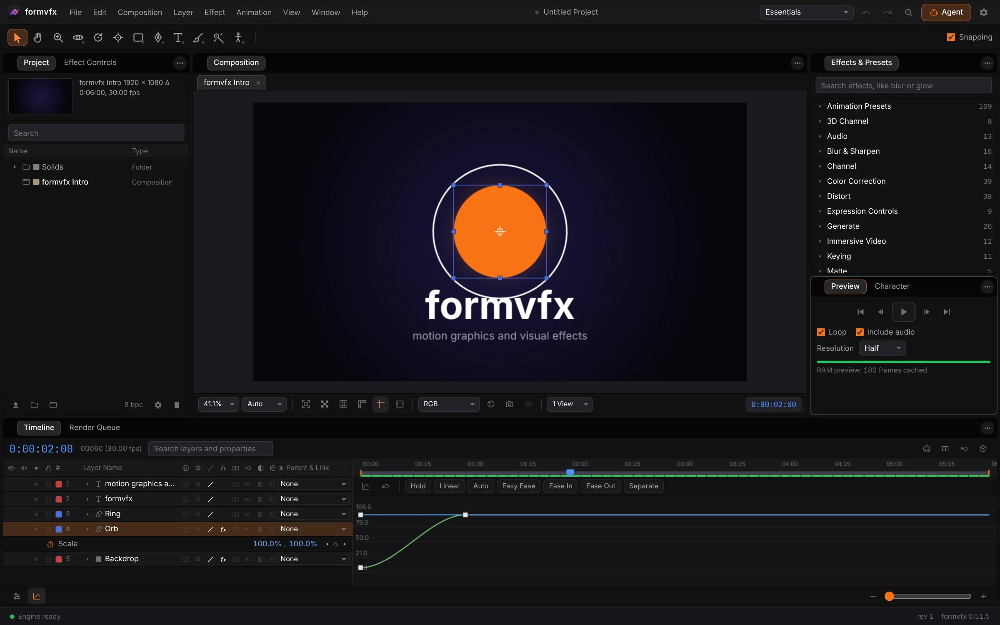
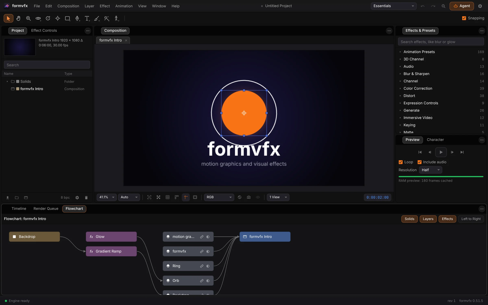

<p align="center">
  
</p>

<h1 align="center">FormVFX</h1>

<p align="center">
  <b>Motion graphics and VFX; a compositor for the Form family.</b><br>
  Compositions, keyframes, text animators, masks, tracking, 3D and a Render Queue,<br>
  with OpenFX and WebAssembly plug-ins. It runs on your own machine, and agents composite over MCP.
</p>

<p align="center">
  
  
  
  
  
  
</p>

<p align="center">
  <a href="https://formvfx.formai.studio/"><b>Download FormVFX on formai.studio</b></a> ·
  <a href="#run-it-from-source">Run it from source</a>
</p>

<br>

<p align="center">
  
  <br>
  <sub>A Launch Week title comp: text over a photo, with the Bounce In Characters animation preset in the Effects and Presets panel.</sub>
</p>

<p align="center">
  <a href="#features">Features</a> ·
  <a href="#everything-in-the-box">In the box</a> ·
  <a href="#built-for-agents">Agents</a> ·
  <a href="#under-the-hood">Under the hood</a> ·
  <a href="#download">Download</a> ·
  <a href="#run-it-from-source">Run from source</a>
</p>

<br>

<table>
  <tr>
    <td width="25%" valign="top"><h3>Its own engine</h3>A compositing engine written in Rust, rendering on the GPU through wgpu or on the CPU, whichever is faster for the comp.</td>
    <td width="25%" valign="top"><h3>Plug-ins that load</h3>Loads OpenFX plug-ins and sandboxed WebAssembly effect plug-ins, with their on-screen handles in the viewer.</td>
    <td width="25%" valign="top"><h3>Templates open</h3>Opens <code>.mogrt</code> templates and <code>.aep</code> projects, and keeps its own <code>.fvxproj</code> projects.</td>
    <td width="25%" valign="top"><h3>Agent-ready</h3>The same commands from the interface, the command line and an MCP server, so Claude Code, Codex and Cursor can drive every tool.</td>
  </tr>
</table>

<br>

## Features

<table>
  <tr>
    <td width="50%" valign="top">
      
      <br><sub>The Graph Editor beside the layer stack, with the Effects and Presets list on the right.</sub>
      <h3>Keyframes and the Graph Editor</h3>
      Shape every ease on a curve, with Hold, Linear, Ease In and Ease Out one click away. The work area renders into the preview cache while you work.
    </td>
    <td width="50%" valign="top">
      
      <br><sub>The Flowchart: solids, effects and layers wired into a composition.</sub>
      <h3>A node view of the comp</h3>
      Drag a link to parent a layer or set a track matte, and drag effects to reorder a stack. It is the same project, seen as a graph.
    </td>
  </tr>
</table>

## Everything in the box

<table>
  <tr>
    <td width="33%" valign="top"><h4>306 effects</h4>Keying · Color Grade · OCIO transforms · Blur and Sharpen · Distort · Particles and simulations · 3D Channel passes · Cryptomatte · 13 audio effects</td>
    <td width="33%" valign="top"><h4>Animate and build</h4>Text animators with 169 presets · Shape layers · Masks · Roto Paint · Puppet pins · 3D cameras and lights · Tracking and stabilizing · Expressions · Scripts · Render Queue</td>
    <td width="33%" valign="top"><h4>Formats</h4>Opens: stills, image sequences, OpenEXR, PSD, PDF and .ai, Lottie, <code>.mogrt</code>, <code>.aep</code> · Saves: H.264, HEVC, AV1, ProRes 4444, WebM, GIF, PNG, TIFF, EXR, WAV · Native: <code>.fvxproj</code></td>
  </tr>
</table>

## Built for agents

Claude Code starts inside the app already connected, and the command line and MCP server reach the same commands as the interface.

```sh
./formvfx state                 # the open project, active comp, selection and time
./formvfx exec comp.list        # list the compositions
./formvfx render --wait         # render the Render Queue and poll until it is done
./formvfx mcp                   # MCP server on stdio for Claude Code, Codex and Cursor
```

`.mcp.json`, `.codex/config.toml` and `.cursor/mcp.json` are already wired in this repo. See [`AGENTS.md`](AGENTS.md).

## Under the hood

Version 0.52.8 · Apache-2.0 · compositing engine: FormVFX's own, in Rust (`native/fvx-core`)

- **Engine:** `native/fvx-core` is the compositing engine, Rust with PyO3, loaded by the engine service as the `fvx_core` extension.
- **Service:** a FastAPI engine service in `backend`, with the MCP server and the embedded terminal.
- **Interface:** TypeScript and Vite in `frontend`, in 26 languages, with a Tauri 2 desktop shell in `src-tauri`.
- **Color:** 8, 16 and 32-bit projects with colour management, OCIO and ACES.
- **Tested:** backend and desktop-shell test suites under `backend/tests` and `frontend/tests`.

## Download

| Platform | Download | Release |
|---|---|---|
| macOS | [Download FormVFX for macOS](https://formai.studio/get/formvfx/macos) | [FormVFX releases on FormCompiler](https://github.com/nodemode-dev/formcompiler/releases?q=formvfx-v&expanded=true) |
| Windows | [Download FormVFX for Windows](https://formai.studio/get/formvfx/windows) | [FormVFX releases on FormCompiler](https://github.com/nodemode-dev/formcompiler/releases?q=formvfx-v&expanded=true) |
| Linux | [Download FormVFX for Linux](https://formai.studio/get/formvfx/linux) | [FormVFX releases on FormCompiler](https://github.com/nodemode-dev/formcompiler/releases?q=formvfx-v&expanded=true) |

All FormVFX builds are compiled and released from [FormCompiler](https://github.com/nodemode-dev/formcompiler); this repo holds the source.

## Demo

Open [`demo/index.html`](demo/index.html) in a browser, no install and no network: composite your own image or video with keyframes, effects, mattes and masks, read the scopes, and render PNG, GIF, WebM or a PNG sequence. It runs a compact TypeScript compositor under the app's own interface, not the Rust engine. See [`demo/README.md`](demo/README.md).

## Run it from source

Prefer it in your browser, or want to contribute? Run the web UI straight from this repo.

**Requires:** Node 20.19+ or 22.12+, Python 3.12+, and Rust 1.95 or newer for the compositing engine.

```sh
git clone git@github.com:nodemode-dev/formvfx.git
cd formvfx
./formvfx doctor    # checks Node, Python, the Rust version and the ports
./formvfx install   # engine venv, the Rust engine (the first build takes a few minutes), interface packages
./formvfx           # engine on 127.0.0.1:8250, web UI at http://localhost:5250
```

`./formvfx desktop dev` opens the desktop window instead.

On Windows use `formvfx.bat install` then `formvfx.bat`. The interface is on port 5250 and the engine on 8250; `FORMVFX_GPU=0` keeps rendering on the CPU.

> [!IMPORTANT]
> **Status:** in development. [`docs/PARITY.md`](docs/PARITY.md) lists where FormVFX trails the reference compositor and what it does not do yet.

**Contributing:** branch from `main`, keep changes to source here, and leave packaging and releases to FormCompiler. See [`.docs/BRANCHING.md`](.docs/BRANCHING.md) and [`AGENTS.md`](AGENTS.md).

## Repository

| Path | What it is |
|---|---|
| `native/`, `backend/`, `frontend/` | the Rust engine, the FastAPI engine service and the Vite interface |
| `src-tauri/`, `presets/`, `docs/` | the desktop shell, text animation presets, [manual](docs/MANUAL.md) and [plug-in guide](docs/PLUGINS.md) |

Docs: [`.docs/wiki`](.docs/wiki) · Agents: [`CLAUDE.md`](CLAUDE.md), [`AGENTS.md`](AGENTS.md) · Contributing: [`.docs/BRANCHING.md`](.docs/BRANCHING.md)

<br>

---

## Maintainers

| Maintainer | Role |
|---|---|
| [@nodemode-ai](https://github.com/nodemode-ai) | Owner |
| [@gbarnai](https://github.com/gbarnai) | Co-owner |

Code owners are set in [`.github/CODEOWNERS`](.github/CODEOWNERS).

## License

FormVFX is licensed under the Apache License 2.0 ([`LICENSE`](LICENSE), SPDX `Apache-2.0`). Copyright 2026 NodeAgentc, Inc. Third-party notices: [`NOTICE.md`](NOTICE.md).

<sub>Product names that people may associate with the file formats FormVFX reads are trademarks of their respective owners. FormVFX is an independent project and is not affiliated with or endorsed by them. See `NOTICE.md`.</sub>
